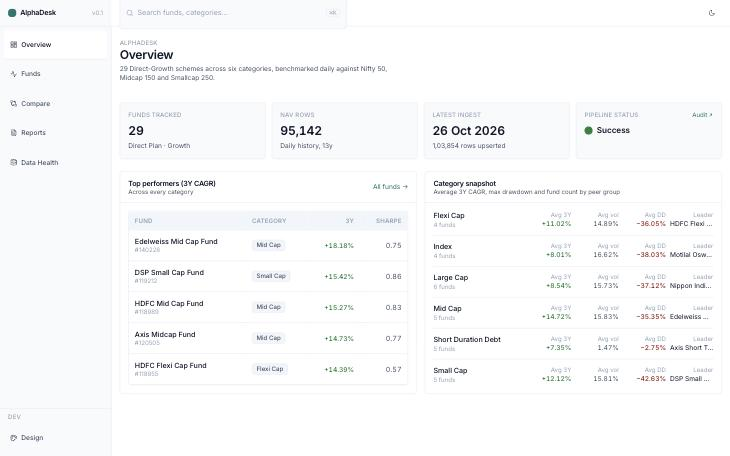
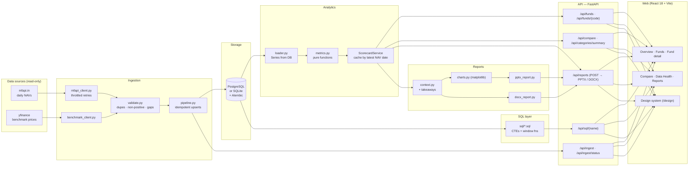
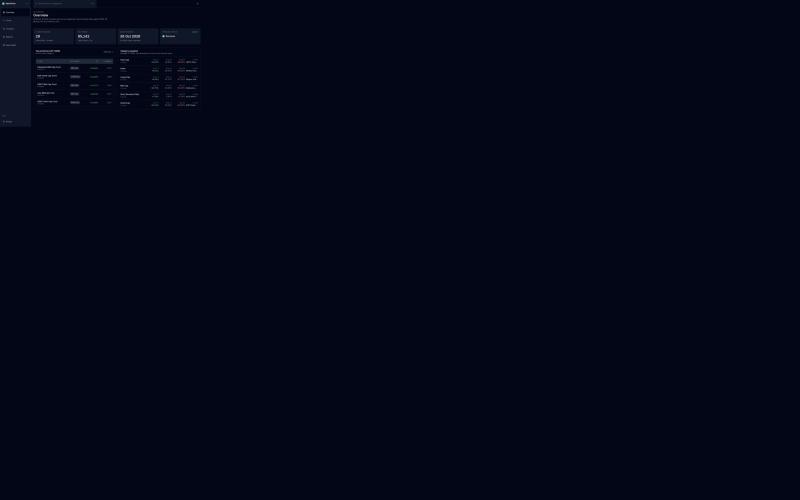
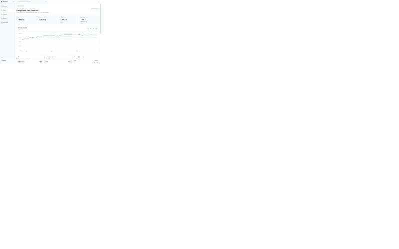
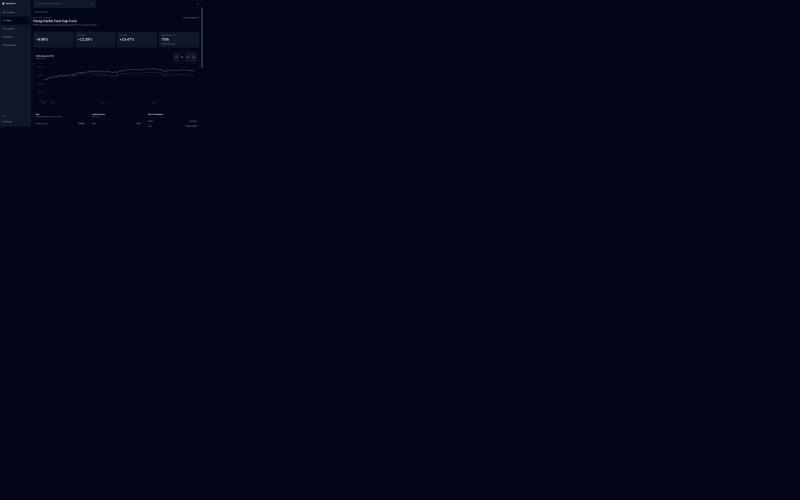
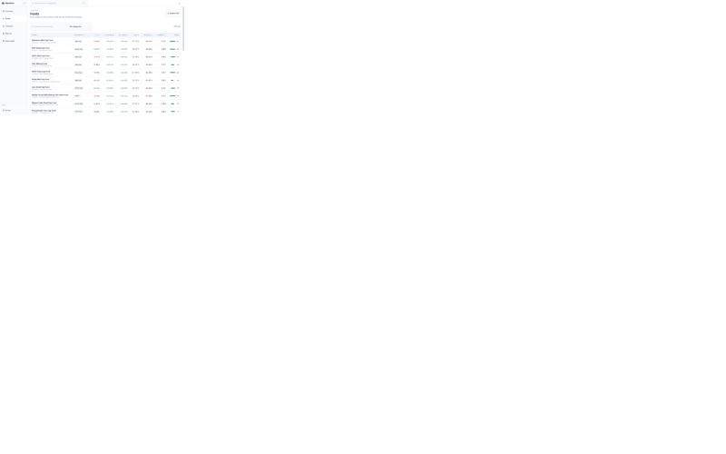
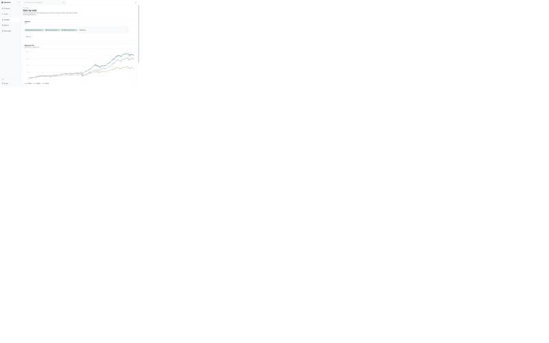
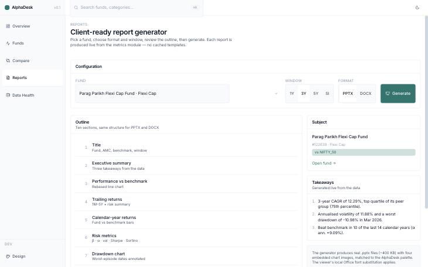
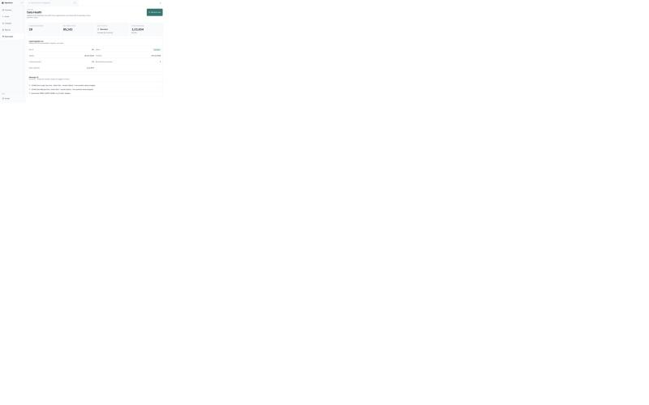

# AlphaDesk

**Institutional-grade mutual fund performance analytics and automated client reporting for Indian mutual funds.**

Pulls daily NAV history for 29 Direct Plan - Growth schemes from [mfapi.in](https://api.mfapi.in/) and benchmark data via yfinance; computes a full set of return, risk and benchmark-relative metrics; surfaces them in a quiet, information-dense web dashboard; and generates client-ready PowerPoint decks and Word reports with one click.

<p align="center">
  
</p>

---

## What's inside

- **29 real Direct-Growth schemes** across six categories (Large / Mid / Small / Flexi Cap, Index, Short Duration Debt). Every scheme code was verified against mfapi before being added to the universe.
- **Idempotent ingestion** of ~95k NAV rows + 8.7k benchmark rows (Nifty 50, Midcap 150, Smallcap 250). Validator catches non-positive NAVs, duplicate dates and gaps > 7 days without silently dropping data — everything lands in the `ingestion_runs` audit table.
- **Metrics module** on daily returns: 1M/3M/6M trailing + 1Y/3Y/5Y CAGR, annualised volatility, Sharpe, Sortino, max drawdown with peak/trough/recovery dates, beta, Jensen's α, tracking error, information ratio, up/down capture, rolling-window returns, pct-beat-benchmark, in-category percentile rank. Every formula has hand-computed test coverage.
- **5 analyst SQL files** (CTEs + `ROW_NUMBER`, `RANK`, `NTILE`, `LAG`, `FIRST_VALUE`, `GROUP_CONCAT`) exposed through `/api/sql/{name}`.
- **FastAPI** with 11 typed routes, OpenAPI docs at `/docs`, scorecard caching invalidated by ingest.
- **React 18 + Vite + Tailwind** dashboard: Overview, Funds (filterable + sortable + CSV export), Fund Detail (scorecard + NAV chart + drawdown + rolling returns), Compare (2–6 funds, rebased), Data Health, Reports. Design system is hand-rolled (no shadcn defaults left behind), with both light and dark themes.
- **PPTX + DOCX report generator** that produces consulting-style client decks: 10 slides, matched palette, matplotlib charts styled to the same tokens as the web.

---

## Quickstart (3 commands past setup)

```bash
make setup       # installs backend .venv + frontend node_modules, writes .env
make migrate     # alembic upgrade head (creates SQLite at data/alphadesk.db)
make ingest      # fetches NAVs for all 29 funds + 3 benchmarks (~2 min)

make dev-api     # http://localhost:8000  (/docs for OpenAPI)
make dev-web     # http://localhost:5173
```

Docker Compose path:

```bash
docker compose up --build
```

---

## Architecture



---

## Screens

### Overview

A hero bar with the pipeline's live state (funds, NAV rows, latest ingest), then top performers by 3Y CAGR and a per-category snapshot that doubles as navigation into filtered Fund lists.

<p align="center">
  
  <br/>
  
</p>

### Fund detail

Scorecard header (1Y / 3Y / 5Y / peer rank "75th within Flexi Cap"), NAV rebased against the benchmark with a dashed benchmark line, drawdown over time, rolling 3Y CAGR vs benchmark, and the worst-drawdown episode (peak → trough → recovery dates).

<p align="center">
  
  <br/>
  
</p>

### Funds list

Sortable table with inline percentile-rank bars, right-aligned numeric columns, tabular-nums, pos/neg colour only on the return deltas, and a CSV export of the current filtered view.

<p align="center">
  
</p>

### Compare

Pick 2–6 funds, see them rebased to 100 on their common trading-date start, with an aligned metrics table that only shows numbers that exist on the overlap window.

<p align="center">
  
</p>

### Reports

Pick a fund + window + format (PPTX or DOCX). The outline and the three generated takeaways render before you click Generate. The server streams a 400 KB file back as a download; same palette and typography as the web.

<p align="center">
  
</p>

Sample output: a 10-slide deck with executive summary, performance-vs-benchmark line chart, trailing-returns table, calendar-year grouped bars, risk-metrics grid, drawdown with worst-episode annotation, rolling 3Y, in-category leaderboard, methodology + disclaimer.

### Data Health

Last ingestion run with row counts, warnings surfaced verbatim ("1 non-positive values dropped"), and a Refresh now button that triggers a background pipeline run.

<p align="center">
  
</p>

---

## Metric definitions

| Metric | Formula | Notes |
| --- | --- | --- |
| Daily return | `r_t = p_t / p_{t-1} - 1` | Simple returns on NAV |
| Trailing return (< 1Y) | `p_end / p_start - 1` | Snapped to last trading day on or before `end - N months` |
| Trailing return (≥ 1Y, CAGR) | `(p_end / p_start)^(1/years) - 1` | `years = (end - start).days / 365.25` |
| Annualised volatility | `std(r) · √252` | Sample std (ddof=1) |
| Max drawdown | `min(p_t / running_max(p)_t - 1)` | Returns (peak, trough, recovery) dates |
| Sharpe | `mean(r - r_f) / std(r - r_f) · √252` | `r_f` from configurable annual rate (default 6.5%) |
| Sortino | `mean(r - r_f) / RMS(downside) · √252` | Downside = excess < 0 only |
| Beta | `cov(r_f, r_b) / var(r_b)` | Both daily, aligned on common dates |
| Jensen's α | `R_f,ann − [r_f + β · (R_b,ann − r_f)]` | CAGR on overlapping sample |
| Tracking error | `std(r_f − r_b) · √252` | |
| Information ratio | `(R_f,ann − R_b,ann) / TE` | |
| Up / Down capture | Compound fund return / compound bench return, restricted to up (down) bench days | |
| Pct beat benchmark | Share of rolling windows where fund rolling return > bench rolling return | |
| Peer percentile rank | Rank within category by 3Y CAGR, normalised to [0, 100] | Higher = better |

NaN results carry a human-readable `reason` ("fewer than 2 aligned returns", "benchmark variance is zero", etc.) all the way to the API and the UI — numbers are never silently fabricated.

---

## Key insights (from the data)

Full write-up in [INSIGHTS.md](INSIGHTS.md) and the executable [notebooks/insights.ipynb](notebooks/insights.ipynb).

1. **Three Nifty 50 index funds track within 6 bps** of 5Y CAGR. Pick on expense ratio.
2. **Parag Parikh Flexi Cap earned ~2× the Sharpe of its peers** (0.94 vs peer-avg 0.54) with 6.5 pp less max drawdown — the risk-adjusted winner, not the absolute-return winner.
3. **Mid-cap manager selection is worth 6.64 pp per year**: Edelweiss 18.18% vs DSP 11.54% 3Y CAGR, same mandate.
4. **Every small-cap fund has a historical drawdown ≥ 34%**; two of five breached 48%. The 5Y 15% CAGR story and the "nearly halved your money" story are the same timeline.
5. **Short-duration debt is a 70-bps-wide distribution** — pick lowest expense ratio.
6. **Only 5 of 20 active equity funds** beat their benchmark in all five of the last calendar years (HDFC Flexi, Kotak Flexi, SBI Large, ICICI Large, Nippon Small). In March 2020 alone, equity categories lost 22–29% in a single month.

---

## Testing approach

```bash
make test                     # pytest suite (69 passing)
cd frontend && npm run typecheck   # strict TS, zero errors
```

**69 passing tests** across:

| Area | What's tested |
| --- | --- |
| `test_validate.py` | Validator catches duplicates, non-positive NAVs, gaps > 7 days |
| `test_universe.py` | Universe loader produces the expected 29 funds × 4 benchmarks |
| `test_metrics.py` | **Every** metric against hand-computed arithmetic: CAGR formula edge cases, trailing returns, vol on alternating ±1% returns, drawdown with exact peak/trough/recovery dates, beta=2 for a doubled series, alpha=0 for `fund==bench`, up-capture=2.0 on single-day 2× scenario, cat percentile rank in both directions, scorecard composite, input validation |
| `test_api.py` | Every endpoint: filter / search / sort / limit, NaN-last ordering, Parag Parikh's March-2020 trough, compare rebase=100 on first point, 400 / 404 on bad inputs, OpenAPI tag coverage |
| `test_sql.py` | Each of the 5 SQL files executes against the live DB; March 2020 is the worst month for every equity category (regression anchor) |
| `test_reports.py` | PPTX has exactly 10 slides and contains the fund name; DOCX has every expected heading + ≥ 4 tables + ≥ 1 image; endpoint returns right MIME, Content-Disposition, X-Report-Filename |

Hand-computed numbers (not "same formula on both sides") are the test design here — if a formula drifts, the test catches it rather than mirroring the drift.

---

## Project layout

```
AlphaDesk/
├── backend/
│   ├── alembic/            Alembic migrations
│   ├── app/
│   │   ├── routers/        FastAPI routers (funds / compare / categories / ingest / reports)
│   │   ├── services/       scorecard caching
│   │   ├── config.py       pydantic-settings
│   │   ├── db.py           SQLAlchemy engine
│   │   ├── models.py       ORM schema
│   │   └── schemas.py      Pydantic response types
│   ├── analytics/
│   │   ├── loader.py       NAV / benchmark Series from DB
│   │   └── metrics.py      pure metric functions
│   ├── ingestion/
│   │   ├── mfapi_client.py throttled retries via tenacity
│   │   ├── benchmark_client.py
│   │   ├── validate.py
│   │   ├── pipeline.py     dialect-aware upserts
│   │   └── cli.py          `python -m ingestion.cli`
│   ├── reports/
│   │   ├── tokens.py       palette + typography (mirrors frontend)
│   │   ├── charts.py       matplotlib wrappers
│   │   ├── context.py      ReportContext builder + takeaways
│   │   ├── pptx_report.py  10-slide deck
│   │   ├── docx_report.py  structured document
│   │   └── generator.py    public entry point
│   ├── sql/                5 analyst SQL files
│   ├── tests/
│   └── Dockerfile, pyproject.toml
├── frontend/
│   ├── src/
│   │   ├── components/     hand-rolled primitives (Button, Table, Chart, Sparkline, …)
│   │   ├── pages/          Overview, Funds, FundDetail, Compare, Reports, DataHealth, Design
│   │   ├── hooks/queries.ts   TanStack Query hooks
│   │   ├── lib/            api client, format helpers, theme
│   │   ├── styles/tokens.css  design tokens (light + dark)
│   │   └── types/api.ts
│   └── tailwind.config.ts, vite.config.ts
├── config/funds.yaml       the fund universe
├── docs/screenshots/
├── notebooks/insights.ipynb
├── docker-compose.yml, Makefile, INSIGHTS.md
```

---

## Design decisions

**SQLite fallback over postgres-only.** Local dev stays infra-free: `make setup && make ingest` under 60 s on a cold laptop. Postgres path remains authoritative via docker-compose; upserts are dialect-aware so neither path degrades. Not production-grade either way, but it means a reviewer can clone, run, and read the dashboard without reaching for Docker.

**Idempotent ingestion, no truncate-and-reload.** Re-running `make ingest` is cheap and safe. Row counts stay stable across runs; only new or changed rows are written. This matters the moment the pipeline is scheduled.

**Audit trail first.** The `ingestion_runs` row is written at the *start* of a run, not the end, so a crash still leaves evidence. Validation warnings land there verbatim ("1 non-positive values dropped", "benchmark CRISIL_SHORT_BOND: no yf_ticker, skipped") — nothing silently vanishes.

**Metric results carry a `reason`.** `MetricValue(value=NaN, reason="fewer than 2 aligned returns")` all the way to the API and UI. The dashboard shows "—" with the reason in a tooltip rather than lying about a value, and the viewer can tell the difference between "no data" and "zero".

**Scorecard cache keyed on latest NAV date.** Computing all 29 scorecards takes ~1 s cold. A latest-NAV-date-keyed cache naturally invalidates on ingest and keeps the API in milliseconds otherwise. No TTL to tune.

**Hand-rolled components over shadcn.** The spec called for a "no default shadcn look" surface. Rather than importing shadcn and overriding it piece by piece (which is how most apps end up looking like every other shadcn app), components are hand-written against a token-driven Tailwind config. Fewer files, no vendored primitives, and the `/design` route is the single review surface.

**One palette, four surfaces.** `tokens.css` on the web and `tokens.py` on the backend reports module define the same colours. Charts in matplotlib use those hex values; PPTX cards use the same RGB triplets. A palette change moves the web and the deck together.

**Reports use real matplotlib, not an LLM summary.** The three "takeaways" in the executive-summary slide are generated deterministically from the data (peer rank, drawdown date, calendar-year beat count). Running the generator twice on the same input produces the same bytes.

**No chart junk.** No gradient fills on the fund line, no top/right spines, no 3D effects, no bouncy animations. Thin 1.5px lines, dashed benchmark, hairline gridlines, muted palette, and tabular-nums everywhere a number appears.

---

## Status

- [x] Phase 1 — scaffold, DB schema, ingestion with validation
- [x] Phase 2 — metrics module with hand-computed test coverage
- [x] Phase 3 — SQL analysis + INSIGHTS.md + notebook
- [x] Phase 4 — FastAPI endpoints with Pydantic models
- [x] Phase 5 — design system + /design route
- [x] Phase 6 — dashboard pages (Overview, Funds, Fund detail, Compare, Data Health, Reports)
- [x] Phase 7 — PPTX + DOCX report generator
- [x] Phase 8 — README polish, screenshots, final pass

---

<p align="center" style="color: #94a3b8; font-size: 12px;">
  Built for a Marsh Investments-style investment-tech brief.
  Data: <a href="https://api.mfapi.in">mfapi.in</a> and <a href="https://pypi.org/project/yfinance/">yfinance</a>.
</p>
